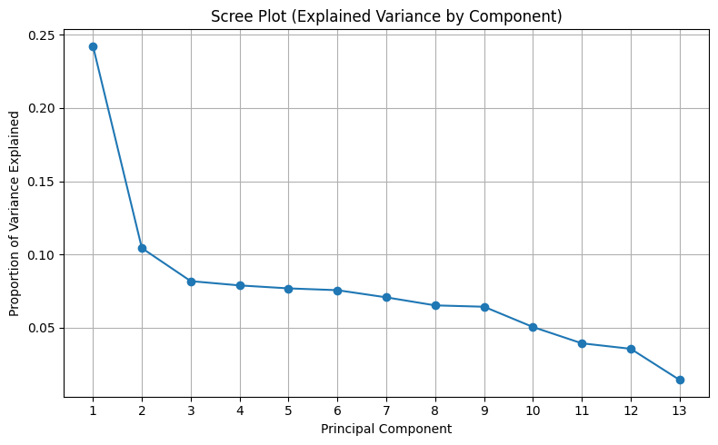
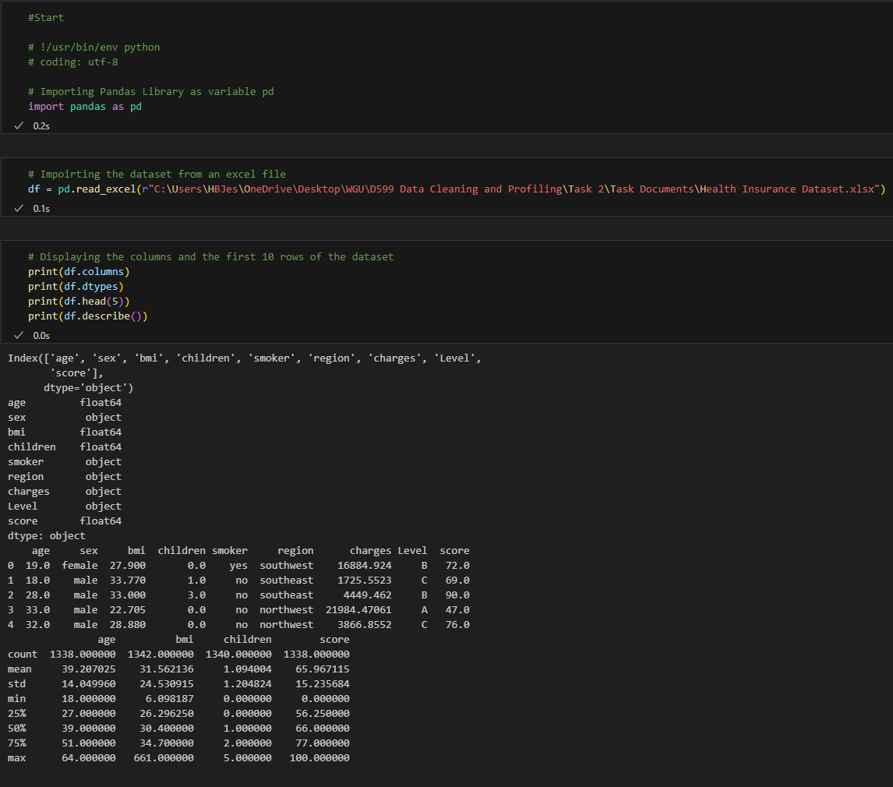
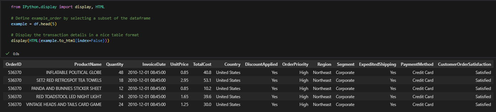

# Statistical Analysis and Market Basket

## Overview
This repo groups seven analytics projects covering data cleaning, business data aggregation, regression modeling, dimensionality reduction, statistical hypothesis testing, and market basket analysis. It demonstrates applied statistics and machine learning across employee turnover, business finance, health insurance, housing, and retail transaction datasets.

## Academic Context
Completed during my M.S. in Data Analytics at Western Governors University (WGU), then packaged here as a public portfolio project. Screenshots from the original written submissions are preserved in `assets/task2-report-extracts/` and `assets/task3-report-extracts/`.

## What It Shows
- data cleaning, profiling, and validation
- grouped business metrics and reproducible spreadsheet outputs
- linear regression modeling and coefficient interpretation
- logistic regression for binary classification
- PCA for dimensionality reduction and variance explanation
- exploratory data analysis
- statistical testing and interpretation
- transaction encoding for basket analysis
- association rule mining and business interpretation

## Included Files
- `notebooks/employee_turnover_cleaning.ipynb`
- `notebooks/business_financial_summary.ipynb`
- `notebooks/linear_regression.ipynb`
- `notebooks/logistic_regression.ipynb`
- `notebooks/pca_analysis.ipynb`
- `notebooks/statistical_tests.ipynb`
- `notebooks/market_basket.ipynb`
- `data/employee_turnover.csv`
- `data/business_financials.xlsx`
- `data/housing_data.csv`
- `data/Health Insurance Dataset.xlsx`
- `data/megastore_transactions.csv`
- `outputs/employee_turnover_cleaned.csv`
- `outputs/state_statistics.xlsx`
- `outputs/businesses_grouped_by_state_debt_to_equity_ratio.xlsx`
- `outputs/debt_to_equity_ratio_by_state.xlsx`
- `requirements.txt`

## Results

- The employee turnover cleaning workflow reduces the source dataset from `10,199` rows to a validated `4,464`-row cleaned output.
- The business finance workflow reproduces the original state-level statistics and debt-to-equity output workbooks from the source coursework folder.
- One-way ANOVA on BMI by region found a statistically significant regional difference with `F = 39.4069` and `p = 0.0000`.
- Mann-Whitney U testing for smoker status versus medical charges produced `p = 4.58e-129`, strongly supporting a meaningful cost difference between smokers and non-smokers.
- The market basket analysis surfaced top Apriori rules with support of `0.011338`, perfect confidence of `1.0`, and lift of `88.2`.
- The strongest retail rules linked themed children's gift items, making the repo a good example of translating association rules into bundling and cross-sell strategy.

The [original finance workflow diagram](assets/business-finance-flowchart.png) traces the input checks, grouping and workbook outputs in the business finance notebook.

## Housing models on 7,000 properties

| Question | Method | Saved result |
|---|---|---|
| How closely do square footage and school rating track sale price? | [Linear regression and residual diagnostics](notebooks/linear_regression.ipynb) | The reduced model explains 29.5% of the training-set price variance. |
| Can property features distinguish luxury homes? | [Logistic regression](notebooks/logistic_regression.ipynb) | The model classified 67.21% of held-out properties correctly. |
| How much information about price survives dimensionality reduction? | [Principal component regression](notebooks/pca_analysis.ipynb) | The component-based regression explains 62.9% of training-set price variance. |

The two R² values describe fits to training data. The classification accuracy is a held-out result for a different target.

[Browse all 15 housing figures](assets/housing/README.md), including the original model diagnostics and the luxury-classification plots.

## Selected Visuals

