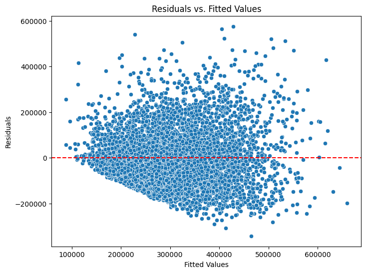

# Applied statistics, housing models and retail market baskets

**Which products are worth bundling?** I used Apriori to analyze 8,234 retail line items grouped into 441 baskets. One of the strongest combinations of children’s gift items had **100% confidence and a lift of 88.2**, yet the items appeared together in **only five baskets**. That makes the combination a candidate for a small merchandising trial. I have not tested a storewide offer, so I cannot estimate its sales from these baskets.

[Open the market-basket analysis](notebooks/market_basket.ipynb) · [Browse the housing figures](assets/housing/README.md) · [Inspect the exported workbooks and data](outputs/)

## Four analyses across business, insurance and retail

| Analysis | What I did and what a reviewer can check |
|---|---|
| [Employee turnover data quality](notebooks/employee_turnover_cleaning.ipynb) | Profiled and cleaned a 10,199-row source. The cleaning rules retained 4,464 records (43.8%). The notebook explains exclusions and their effect on the represented population. Compare the transformations with the [cleaned CSV](outputs/employee_turnover_cleaned.csv) before using this sample for workforce analysis. |
| [Business finance by state](notebooks/business_financial_summary.ipynb) | Aggregated business records into 40 state summaries and three Excel outputs, including average debt-to-equity ratios. See the [workflow diagram](assets/business-finance-flowchart.png) and [state statistics](outputs/state_statistics.xlsx). |
| [Health-insurance costs](notebooks/statistical_tests.ipynb) | Used one-way ANOVA to compare mean BMI across regions (F = 39.4069, p < 0.001). A Mann–Whitney U test found a difference in the distribution of charges by smoking status (p ≈ 4.59 × 10⁻¹²⁹). Neither test estimates the effect of an intervention. |
| [Retail product combinations](notebooks/market_basket.ipynb) | Encoded each order as a set of products and ranked association rules. Lift compares co-occurrence with independence. The top rule’s 1.13% support shows how rarely the combination appeared. |

## Housing models on 7,000 properties

| Question | Implementation | Result |
|---|---|---|
| How much price variation does home size explain? | [Linear regression and residual checks](notebooks/linear_regression.ipynb) | The final model uses square footage and school rating: 35.4% training R². The size-only comparison explains 29.5%. |
| Can property features distinguish luxury homes? | [Logistic regression](notebooks/logistic_regression.ipynb) | Correctly classified 67.21% of held-out properties. |
| Can a smaller set of components describe prices? | [Principal component regression](notebooks/pca_analysis.ipynb) | The component-based model explained 62.9% of training-set price variance. |

The price models’ R² values describe fits to training data. The luxury model reports test accuracy for a different outcome. The [gallery of 15 figures](assets/housing/README.md) includes residual diagnostics, luxury-classification plots and the PCA scree plot.

The [housing model report](docs/housing-model-results.md) explains model selection, evaluation metrics and residual diagnostics. I fitted the PCA preprocessing before the split, so I treat its test error as exploratory.

## Run it yourself

Install the [requirements](requirements.txt) in a Jupyter environment and open the notebook for the question that interests you. Use `notebooks/` as the working directory. The five source datasets are included, and the notebooks can be reviewed independently. [Source data](data/) · [Insurance report figures](assets/insurance-report-figures/) · [Market-basket report figures](assets/market-basket-report-figures/)

## Data and environment

Data: WGU business, employee, insurance, housing and retail datasets; [source notes](data/README.md).  
Install: `python -m pip install -r requirements.txt`; [environment details](requirements-verified.txt).

*WGU M.S. in Data Analytics coursework, D598 Analytics Programming, D599 Data Cleaning and Profiling, and D600 Statistical Data Mining.*
